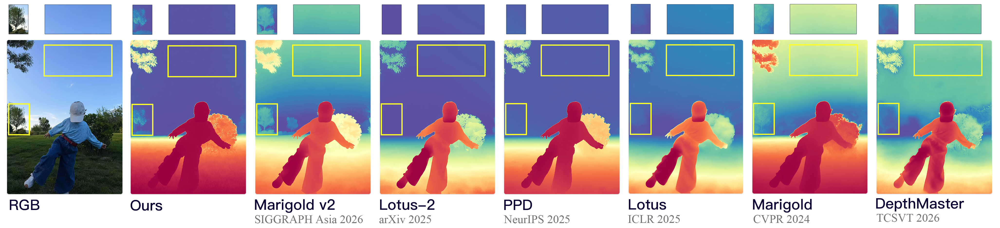

<div align="center">
<h1>Mind The Sky: SSD-1B Depth Estimation</h1>
<p>Validity-guided diffusion depth estimation with Segmind SSD-1B</p>

</div>

This is the **SSD** branch, based on `main` (`48fc883`). It fine-tunes
[segmind/SSD-1B](https://huggingface.co/segmind/SSD-1B) using the same depth method.
`main` remains SD2; `nightly` remains full SDXL. The [original SD2 README](doc/main_sd2.md)
is retained for reference.

SSD uses SDXL's dual CLIP and `text_time` conditioning, with a different U-Net.
We load SSD's own configuration and weights, including its asymmetric transformer
depths and non-attentional mid block. SD2/full-SDXL depth weights cannot substitute for SSD.

## Method and retained features

Only the full SSD U-Net is optimized. VAE, CLIPs and DA2 stay frozen. Empty text
conditions are cached once, then both CLIPs are released. VAE scaling comes from
SSD's config (`0.13025`). VAE and DA2 remain FP32 even with optional FP16 enabled.

| Component | SSD behavior |
| --- | --- |
| Main objective | RGB(4) + corrected DA2(4) + noisy depth(4), 12-channel U-Net |
| Validity guidance | Region anchor, interior smoothness, corrected DA2 far-region anchor |
| Diffusion | v-prediction, zero terminal SNR, trailing DDIM, Min-SNR floor |
| Noise / geometry | Multi-resolution and offset noise, terminal fade, latent gradient loss |
| Sampling | Main's progressive Hypersim/VKITTI sampling and resume behavior |
| Budget | Main's **8,000 updates**, effective batch **42**, seed 2024 |
| Memory | Microbatch 1, accumulation 42, activation checkpointing, Adam8bit, PyTorch SDPA |
| Learning rate | `1e-5`, following nightly's XL setting; main SD2 uses `3e-5` |
| Precision | FP32 default; explicit `--fp16` AMP, overflow replay and saved scaler |
| Checkpoints | U-Net, matching scheduler and backbone/DA2 metadata; trainer state in `latest` |
| Depth evaluation | Main metrics/alignment, including DIODE Sobel mask refinement |
| Sky evaluation | Mask2Former masks, full-frame inference, `sky_iqr`, `sky_p95_p5`, `sfoe` |
| Ablations | All 15 main variants, including separate terminal fade and genuine 8-channel input |

[`config/train_ssd.yaml`](config/train_ssd.yaml) inherits main's
[`config/train_marigold.yaml`](config/train_marigold.yaml), including objective
weights, sampling and update budget. SD2 configuration remains available.
On-training validation/visualization remain disabled as on main; evaluate separately.
`train.py` defaults to `config/train_ssd.yaml` on this branch; pass
`--config config/train_marigold.yaml` explicitly for the retained SD2 setup.

## Setup and weights

Use Linux or WSL2 with a CUDA-enabled PyTorch environment. Run from the repo root:

```bash
git clone --branch SSD --single-branch https://github.com/Haruko386/ApDepth-G.git
cd ApDepth-G
conda create -n celeste-ssd python=3.12 -y
conda activate celeste-ssd
pip install torch==2.4.1 torchvision==0.19.1 --index-url https://download.pytorch.org/whl/cu118
pip install -r requirements-ssd.txt
export BASE_DATA_DIR=/path/to/datasets
export BASE_CKPT_DIR=/path/to/checkpoints
python script/download_ssd_weights.py --base_ckpt_dir "$BASE_CKPT_DIR"
```

Keep an existing compatible CUDA PyTorch installation if you have one.
`requirements-ssd.txt` includes training, inference, evaluation and sky dependencies;
xformers is unnecessary. The vendored DA2 code includes this project's normalization fixes.

The downloader pins SSD revision `60987f37e94cd59c36b1cba832b9f97b57395a10`, saves
ordinary safetensors Diffusers components to `$BASE_CKPT_DIR/SSD-1B`, and verifies
required files. It excludes duplicate FP16 and A1111 weights. Re-running reuses
Hugging Face's cache/resume support. `--dry-run` prints the plan without network
or file writes; `--revision` explicitly selects another revision.

**Keep main's matching DA2 vitg weights** at
`DA2/checkpoints/depth_anything_v2_vitg.pth`, or configure the path in
[`config/da2.yaml`](config/da2.yaml). Relative DA2 paths resolve from the repo root.
SSD does not contain DA2. The downloader never silently changes the prior.

For public vits/vitb/vitl downloads, first select that encoder in `config/da2.yaml`,
then add `--with-da2`. This changes the experiment from main's default. For vitg,
reuse existing matching weights or supply `--da2-repo REPOSITORY_YOU_CAN_ACCESS`
containing `depth_anything_v2_vitg.pth`. Missing vitg weights produce an actionable
error. Standard Hugging Face login/`HF_TOKEN` applies if access is required.

Prepare Hypersim and Virtual KITTI 2 under `$BASE_DATA_DIR`, using the existing
[Hypersim instructions](script/dataset_preprocess/hypersim/README.md) and
[`config/dataset/dataset_train.yaml`](config/dataset/dataset_train.yaml).
Datasets, splits, augmentation and preprocessing are inherited from main.

## Train and resume

First probe memory using two optimizer updates with real samples from both datasets:

```bash
python train.py --config config/train_ssd_probe.yaml \
  --base_data_dir "$BASE_DATA_DIR" --base_ckpt_dir "$BASE_CKPT_DIR" \
  --output_dir output/ssd_probe --no_wandb
```

The probe writes `output/ssd_probe/train_ssd_probe/memory_profile.json`, including
allocated optimizer state, peak allocated/reserved and device free memory. It
saves no model weights. Use a fresh output directory for each run. Measure on your
GPU; no full SSD training VRAM figure is claimed here.

```bash
python train.py --config config/train_ssd.yaml \
  --base_data_dir "$BASE_DATA_DIR" --base_ckpt_dir "$BASE_CKPT_DIR" \
  --output_dir output/ssd --no_wandb
```

This creates `output/ssd/train_ssd/`. Append `--fp16` to explicitly enable AMP for
training or the probe. Master parameters remain FP32. Gradient overflow retries
the same accumulated batch before advancing the update count and schedules.

```bash
python train.py --resume_run output/ssd/train_ssd/checkpoint/latest \
  --base_data_dir "$BASE_DATA_DIR" --base_ckpt_dir "$BASE_CKPT_DIR" --no_wandb
```

Resume reads the run's saved `config.yaml`; keep its directory layout intact.
Pass `--fp16` again for AMP resume; otherwise resume uses FP32. `latest` has
optimizer/trainer state; the final `iter_008000` is an inference checkpoint.
Do not resume SD2/SDXL runs as SSD.

## Inference

The downloaded SSD base is a text-to-image model. Depth inference needs your
**trained SSD U-Net and scheduler**. This branch does not bundle trained SSD depth weights.

```bash
export SSD_CHECKPOINT=output/ssd/train_ssd/checkpoint/iter_008000
python run.py --backbone ssd \
  --checkpoint "$BASE_CKPT_DIR/SSD-1B" --unet_checkpoint "$SSD_CHECKPOINT" \
  --input_rgb_dir input/example-1 --output_dir output/ssd_images \
  --denoise_steps 50 --ensemble_size 10 --processing_res 0 --batch_size 1 --seed 2024
```

Optional `--fp16` casts ordinary weights; no separate FP16 filenames are needed.
Multi-step DDIM, ensembling, resolution controls, color maps and seeded inference
remain available. See `run.py --help`. The default backbone remains `sd2` for
legacy commands: **always pass `--backbone ssd`** when using SSD directly.
Checkpoint metadata restores DA2 and ablation settings. When moving machines,
`--da2_config config/da2.yaml` can relocate the same DA2 encoder/weights.

## Benchmark evaluation

The SSD runner calls `infer.py` and main's unchanged `eval.py`:

```bash
python script/eval_ssd.py \
  --base_data_dir "$BASE_DATA_DIR" --checkpoint "$BASE_CKPT_DIR/SSD-1B" \
  --unet_checkpoint "$SSD_CHECKPOINT" --output_dir output/ssd_eval \
  --datasets nyu kitti eth3d scannet diode \
  --denoise_steps 50 --ensemble_size 10 --processing_res 0 --seed 2024
```

Results: `output/ssd_eval/depth/<dataset>/{prediction,metrics}`.
Use `--eval-only` to score existing predictions or `--dry-run` to inspect commands.
`--datasets vkitti2` uses main's sampled VKITTI validation split. Main's least-square
alignment, ETH3D alignment resolution limit and DIODE filtering are retained.

## Sky masks and sky metrics

Reuse existing main masks. If needed, download a local segmentation checkpoint:

```bash
python script/download_ssd_weights.py --base_ckpt_dir "$BASE_CKPT_DIR" --with-sky-model
```

This adds safetensors/config/processor files for
`facebook/mask2former-swin-large-cityscapes-semantic` at `$BASE_CKPT_DIR/mask2former`.
The mask-generation code itself continues to use local checkpoints only.
Generate masks once if they do not already exist:

```bash
python -B script/dataset_preprocess/sky_mask/segment_sky.py \
  --base_data_dir "$BASE_DATA_DIR" --checkpoint "$BASE_CKPT_DIR/mask2former" \
  --datasets vkitti2 kitti diode \
  --data_split data_split/vkitti/vkitti_val_sampled.txt \
               data_split/kitti/eigen_test_files_with_gt.txt \
               data_split/diode/diode_val_all_filename_list.txt \
  --output_dir output/sky_segmentation/mask2former_v1

python script/eval_ssd.py \
  --base_data_dir "$BASE_DATA_DIR" --checkpoint "$BASE_CKPT_DIR/SSD-1B" \
  --unet_checkpoint "$SSD_CHECKPOINT" --output_dir output/ssd_eval \
  --datasets vkitti2 kitti diode --sky_mask_name mask2former_v1 \
  --denoise_steps 50 --ensemble_size 1 --processing_res 768 --seed 2024
```

Sky inference uses full RGB frames, including KITTI/VKITTI regions excluded by
benchmark crops, and selects only split entries with masks. Predictions are
separate at `output/ssd_eval/sky/<dataset>`. Sky evaluation uses no GT alignment
and writes `metrics/eval_metrics-sky.txt`: **Sky-IQR**, **Sky-P95-P5**, **SFOE**,
with main's normalization, boundary pairing and aggregation. See the
[sky workflow README](script/dataset_preprocess/sky_mask/README.md).

Existing shell sky workflows also accept SSD:

```bash
export BACKBONE=ssd
export CHECKPOINT="$BASE_CKPT_DIR/SSD-1B"
export CELESTE_CHECKPOINT="$SSD_CHECKPOINT"
export SKY_PREDICTION_ROOT=output/sky_predictions/ssd_full
export SKY_EVAL_ROOT=output/sky_eval/ssd_full
bash script/eval/0_infer_eval_all_sky.sh
```

## Ablations and verification

Use [`config/ablation_ssd`](config/ablation_ssd/README.md) with `train.py --config`.
All 15 main variants are retained. `11_8ch_no_vgc` and `12_8ch_vgc` use genuine
RGB(4)+noisy-depth(4) input, initialized by repeating original weights twice / 2.
The latter uses DA2 only for training-time VGC; neither runs DA2 at inference.

```bash
pip install pytest
python -m pytest -q tests
```

Offline tests use real tiny Diffusers/Transformers networks, synthetic data and a
stub DA2 prior. They cover SSD topology, dual conditioning, VAE scaling, training,
accumulation, AMP/scaler resume, multi-step inference, 8-channel variants, config
parity, download plans and full-frame sky inference/evaluation. The official SSD
U-Net configuration is also built on the meta device without allocating weights.

Local tests use CPU PyTorch 2.4.1, Diffusers 0.35.2 and Transformers 4.57.0.
Full pretrained SSD GPU training, CUDA Adam8bit memory and dataset accuracy require
the server probe/full run; synthetic tests do not establish those results.

## License

Project code: [Apache 2.0](LICENSE.txt). SSD uses its
[upstream model terms](https://huggingface.co/segmind/SSD-1B).
DA2 code/models retain their respective licenses; see [DA2/LICENSE](DA2/LICENSE).
